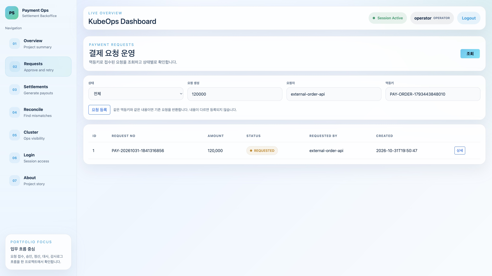
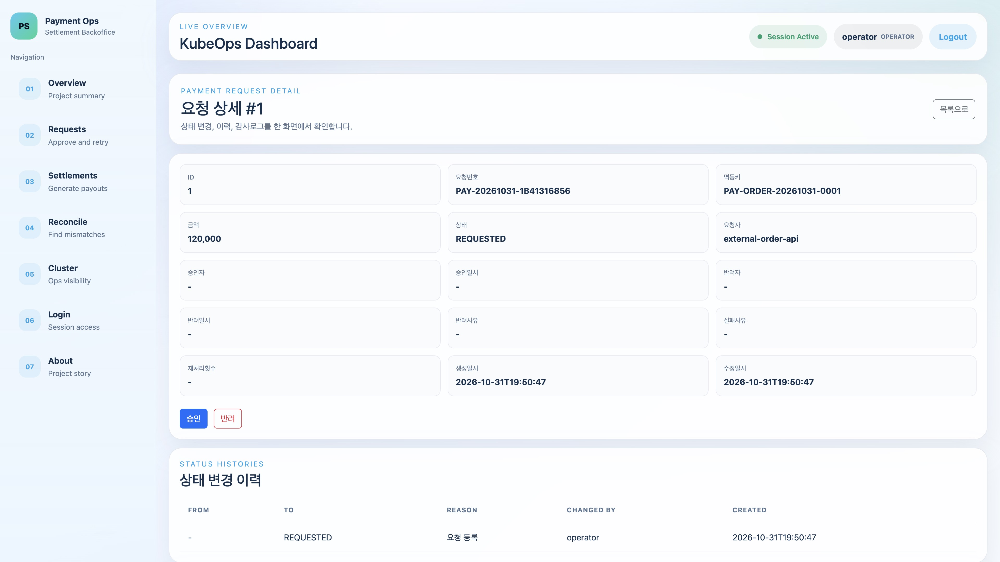
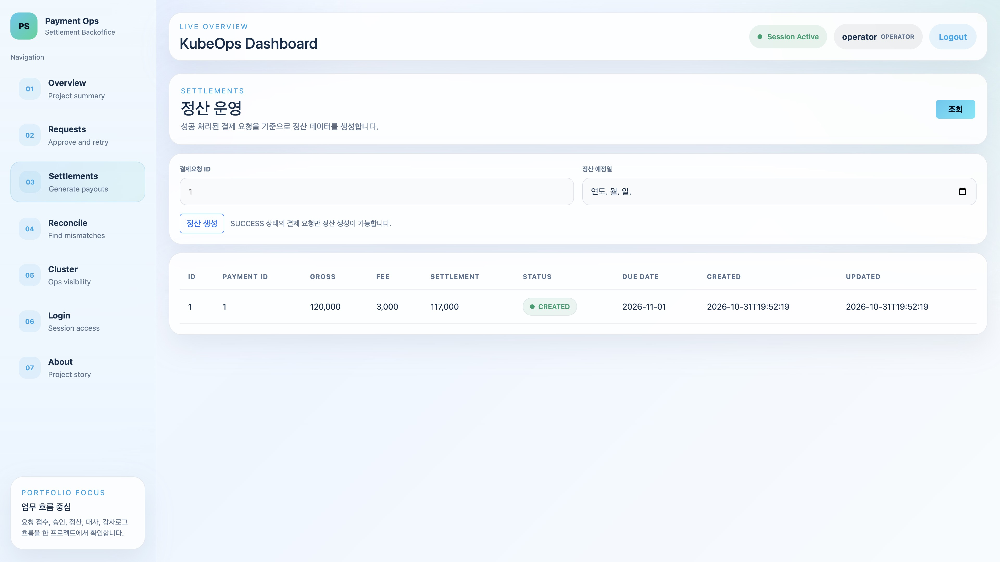
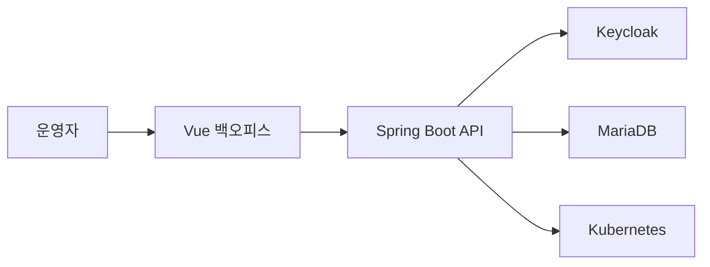
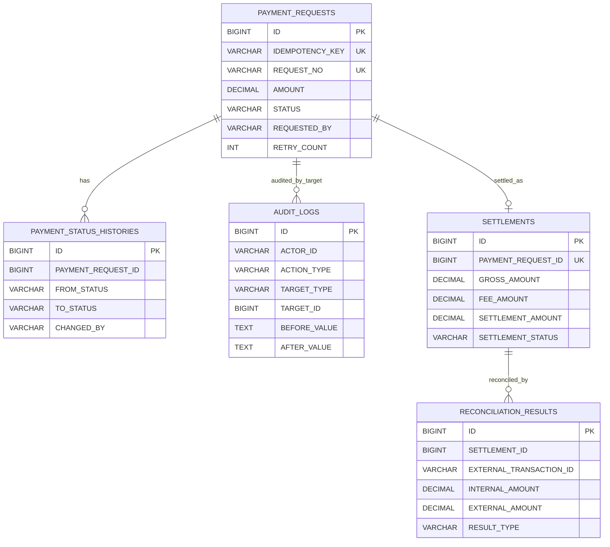

# Payment Operations Backoffice

같은 결제 요청이 두 번 들어와도 한 건만 남기고, 승인 뒤에 처리와 정산으로 상태가 넘어가는 백오피스입니다. 카드 결제를 실제로 일으키지는 않습니다. 운영자가 요청을 받고 승인할 때 생기는 중복 저장, 동시 수정, 권한 문제를 다룹니다.

| | |
|---|---|
| Backend | Java 17, Spring Boot 3, JPA, Security |
| Frontend | Vue 3, Vite, Axios |
| Database | MariaDB |
| 로그인 | Keycloak, 세션, CSRF |
| 실행 | Docker, Kubernetes, Helm, GitHub Actions |
| 테스트 | JUnit 5, Mockito, Testcontainers, MockMvc |

## 화면

운영자로 로그인한 뒤 찍었습니다. 왼쪽부터 요청 목록, 승인할 수 있는 상세, 정산 결과입니다.

<p>
  
  
  
</p>

## 신경 쓴 부분

### 같은 요청이 다시 오면

버튼을 두 번 누르거나 요청이 재시도되면 같은 결제가 또 들어옵니다. `idempotencyKey`를 두고, 데이터베이스 유니크 제약으로 한 번만 저장합니다. 저장은 짧은 트랜잭션으로 나눕니다. 제약에 걸리면 그 트랜잭션은 버리고, 이미 들어간 요청을 다시 읽습니다.

- 키와 내용이 같으면 기존 요청을 돌려줍니다.
- 키는 같은데 금액이나 요청자가 다르면 409를 돌려줍니다.
- 동시에 들어와도 마지막에는 유니크 제약이 한 건만 남깁니다.

### 두 사람이 같이 승인하면

한 요청을 두 운영자가 동시에 승인하면 상태가 꼬이거나 이력이 두 줄 생길 수 있습니다. 지금 상태에서 갈 수 있는 다음 상태만 허용합니다. `@Version`이 같아서 같이 저장하면 먼저 커밋한 쪽만 성공하고, 나머지는 409입니다. 상태, 이력, 감사로그는 한 트랜잭션에 넣습니다.

### 누가 어떤 API를 부르나

로그인은 Keycloak입니다. 역할은 viewer, operator, admin이고, Spring Security 권한으로 바꿉니다. 이 역할은 ID 토큰과 사용자 정보에 들어 있습니다. 브라우저는 세션 쿠키로 로그인 상태를 유지하고, 내용을 바꾸는 요청은 CSRF 토큰을 확인합니다.

## 테스트

단위 테스트는 JUnit 5와 Mockito입니다. 데이터베이스가 필요한 테스트는 MariaDB 컨테이너를 띄웁니다. 중복 등록, 동시 요청, 버전 충돌, 상태 변경, 정산, 권한, CSRF를 확인합니다.

권한과 CSRF 테스트는 로컬에서 통과했습니다. `./gradlew test`와 GitHub Actions의 Backend test도 같은 테스트를 실행합니다.

아래에는 구조, 상태 흐름, API 권한, 실행 방법, Kubernetes, 아직 없는 기능을 적어 두었습니다. Kubernetes 조회는 결제 흐름과 따로인 보조 기능입니다.

## 구조



## 기술을 고른 이유

| 영역 | 기술 | 이유 |
|---|---|---|
| Backend | Java 17, Spring Boot 3.1, Spring MVC, JPA | 요청 검증, 트랜잭션, 저장을 한 애플리케이션에서 처리합니다. |
| Security | Spring Security, OAuth2 Login, HTTP session | 프론트는 토큰을 갖지 않고, 로그인 뒤 세션으로 API를 호출합니다. |
| Auth | Keycloak | 운영 역할을 realm role로 나눕니다. |
| DB | MariaDB | 멱등키와 요청번호에 유니크 제약을 둡니다. 통합 테스트도 같은 DB를 컨테이너로 띄웁니다. |
| Frontend | Vue 3, Vite, Axios | 등록, 승인, 정산, 대사를 화면에서 따라갑니다. |
| Runtime | Docker Compose | 로컬에서 DB, Keycloak, 백엔드, 프론트를 같이 올립니다. |
| Deploy | Helm, Kubernetes | 배포 매니페스트와 헬스체크를 차트에 둡니다. |
| CI | GitHub Actions | 테스트를 실행하고, main에 푸시되면 이미지를 빌드한 뒤 Helm 태그를 바꿉니다. |

## 업무 흐름

```text
요청 등록 REQUESTED
  ├─ 반려 REJECTED
  └─ 승인 APPROVED
       └─ 처리 시작 PROCESSING
            ├─ 실패 FAILED ─ 재처리 RETRYING ─ 성공 SUCCESS 또는 다시 실패
            └─ 성공 SUCCESS
                 └─ 정산 생성 SETTLED
```

재처리는 `FAILED`에서만 가능하고 최대 3회입니다. `REJECTED`와 `SETTLED`에서는 더 이상 상태를 바꾸지 않습니다. 허용되지 않은 전이는 409와 함께 현재 상태를 유지합니다.

`PAYMENT_REQUESTS.VERSION`은 JPA 낙관적 잠금입니다. 승인과 같은 변경은 조회한 버전이 그대로일 때만 커밋되고, 그 사이 다른 트랜잭션이 바꾸면 409가 납니다.

정산은 `SUCCESS`인 요청만 만들 수 있습니다. 금액의 2.5%를 수수료로 빼고, 같은 요청으로 정산을 한 번 더 만들지 않습니다. 대사는 저장된 정산 금액, 상태와 요청으로 들어온 외부 값을 비교합니다. 결과는 `MATCHED`, `AMOUNT_MISMATCH`, `STATUS_MISMATCH`, `EXTERNAL_MISSING`, `INTERNAL_MISSING` 중 하나입니다.

상태를 바꿀 때는 이력과 감사로그를 같은 트랜잭션에 남깁니다. 감사로그에는 누가, 무엇을, 어떤 대상을, 바꾸기 전과 후에 어떤 값으로, 어느 IP에서, 언제 처리했는지 기록합니다.

## 멱등성

같은 `idempotencyKey`와 같은 요청 내용이면 새 행을 만들지 않고 기존 결제 요청을 반환합니다. 비교 대상은 `amount`의 숫자 값과 `requestedBy` 문자열입니다. 이미 승인된 요청을 같은 내용으로 다시 등록해도 상태를 되돌리지 않습니다.

같은 키에 금액이나 요청자가 다르면 409를 반환하고 기존 행은 바꾸지 않습니다.

동시 요청은 아래 순서로 처리합니다.

1. 키로 먼저 조회합니다. 있으면 내용을 비교해 반환하거나 409를 냅니다.
2. 없으면 결제 요청, 상태 이력, 감사로그를 하나의 새 트랜잭션에 저장합니다.
3. 그 트랜잭션이 멱등키 유니크 제약에 걸리면 그 트랜잭션만 롤백합니다.
4. 제약 위반을 바깥에서 잡은 뒤, 커밋된 행을 다시 조회해 같은 내용이면 반환하고 다른 내용이면 409를 냅니다.

유니크 제약에 걸린 트랜잭션 안에서 예외를 잡고 다시 조회하지 않습니다. Hibernate가 그 트랜잭션을 롤백만 가능하게 표시해서, 같은 트랜잭션에서는 조회 결과를 커밋할 수 없습니다. 요청번호가 겹치면 같은 요청의 재시도로 보지 않고, 번호만 새로 만들어 최대 3번 저장합니다.

처음 저장하면 201, 같은 내용으로 다시 오면 200입니다.

마지막 보루는 `UK_PAYMENT_REQUESTS_IDEMPOTENCY_KEY`입니다. 분산 락은 쓰지 않습니다.

## 인증과 인가

`/api/auth/login/keycloak`으로 들어오면 Keycloak 로그인으로 넘어갑니다. 성공하면 백엔드가 세션을 만들고 프론트로 돌려보냅니다. 프론트는 토큰을 저장하지 않고, 쿠키를 실어 API를 호출합니다. realm role `viewer`, `operator`, `admin`은 `ROLE_VIEWER`, `ROLE_OPERATOR`, `ROLE_ADMIN`이 됩니다. Keycloak이 이 역할을 ID 토큰과 사용자 정보에 넣도록 realm에 매퍼를 두었습니다.

역할 계층은 두지 않았습니다. API마다 허용 역할을 적습니다. 로그인하지 않으면 401, 로그인했지만 역할이 없으면 403입니다.

인증 없이 접근 가능한 경로:

| Method | URL | 용도 |
|---|---|---|
| GET | `/api/health/**` | 프로세스와 DB 헬스체크 |
| GET | `/api/auth/health` | 인증 모듈 헬스체크 |
| GET | `/api/auth/csrf` | CSRF 토큰 발급 |
| GET | `/api/auth/login/**` | Keycloak 로그인 시작 |
| * | `/api/oauth2/**`, `/api/login/oauth2/**` | OAuth2 콜백 |
| * | `/api/error` | 오류 응답 |

그 외 API는 인증이 필요합니다.

| Method | URL | 역할 |
|---|---|---|
| GET | `/api/auth/me`, `/api/auth/status` | 인증된 사용자 |
| POST | `/api/auth/logout` | 인증된 사용자 |
| POST | `/api/payment-requests` | OPERATOR, ADMIN |
| GET | `/api/payment-requests`, `/{id}`, `/{id}/histories` | VIEWER, OPERATOR, ADMIN |
| POST | `/api/payment-requests/{id}/approve` | OPERATOR, ADMIN |
| POST | `/api/payment-requests/{id}/reject` | OPERATOR, ADMIN |
| POST | `/api/payment-requests/{id}/process` | OPERATOR, ADMIN |
| POST | `/api/payment-requests/{id}/success` | OPERATOR, ADMIN |
| POST | `/api/payment-requests/{id}/fail` | OPERATOR, ADMIN |
| POST | `/api/payment-requests/{id}/retry` | OPERATOR, ADMIN |
| POST | `/api/settlements/generate` | OPERATOR, ADMIN |
| GET | `/api/settlements`, `/{id}` | VIEWER, OPERATOR, ADMIN |
| POST | `/api/reconciliations` | OPERATOR, ADMIN |
| GET | `/api/reconciliations`, `/mismatches` | VIEWER, OPERATOR, ADMIN |
| GET | `/api/audit-logs` | VIEWER, OPERATOR, ADMIN |
| GET | `/api/k8s/**` | VIEWER, OPERATOR, ADMIN |
| PUT | `/api/k8s/**/scale` | OPERATOR, ADMIN |
| POST, DELETE | `/api/k8s/**` 명령 | ADMIN |

Kubernetes 명령 API는 역할이 맞아도 `app.kubernetes.commands-enabled=false`이면 실행하지 않고 403을 반환합니다. 기본값은 false입니다. 로컬 프로파일과 `compose.local.yml`만 true입니다.

로그인 후 이동 경로는 `/`로 시작하는 내부 경로만 허용합니다. `//host` 같은 값은 `/`로 바꿉니다.

변경 메서드(POST, PUT, PATCH, DELETE)는 CSRF 검사가 있습니다. 세션에 토큰을 두고, `GET /api/auth/csrf`가 `headerName`(`X-CSRF-TOKEN`)과 `token`을 돌려줍니다. Vue Axios는 변경 요청 전에 이 값을 헤더로 다시 보냅니다. 토큰이 없으면 403입니다.

### 요청 예시

```http
POST /api/payment-requests
Content-Type: application/json

{
  "idempotencyKey": "PAY-ORDER-20260530-0001",
  "amount": 120000,
  "requestedBy": "external-order-api"
}
```

```http
POST /api/payment-requests/1/reject
Content-Type: application/json

{
  "reason": "요청 금액과 증빙 금액이 일치하지 않습니다."
}
```

## 데이터 모델



`AUDIT_LOGS`는 결제 요청만의 외래키가 아닙니다. 정산과 대사 결과도 `TARGET_TYPE`으로 기록합니다. 운영 스키마는 `springboot-app/src/main/resources/sql/payment_settlement.sql`입니다. JPA `ddl-auto`는 운영에서 `none`입니다.

`sql/user.sql`과 `sql/render-init.sql`의 `USERS` 테이블은 현재 로그인 경로에서 사용하지 않습니다. 인증 사용자는 Keycloak에 있습니다.

## 로컬 실행

예제 계정과 환경변수는 [docs/local-setup.md](docs/local-setup.md)에 있습니다. 로컬 데모 값이며, 외부에서 접근 가능한 환경에 그대로 두지 않습니다.

```bash
docker compose -f compose.local.yml up -d mariadb keycloak-db keycloak
```

Keycloak realm 파일은 `infra/keycloak/import/kubeops-local-realm.json`입니다. 포트는 8090입니다.

```bash
cd springboot-app
./gradlew bootRun --args='--spring.profiles.active=local'
```

```bash
cd frontend
npm install
npm run dev
```

API는 `http://localhost:8081/api`, 프론트는 `http://localhost:3000`입니다. 결제, 정산, 대사 화면은 로그인 후에 들어갑니다. OAuth client 값은 로컬 실행 문서를 봅니다.

Compose로 백엔드와 프론트까지 함께 올리려면 `docker compose -f compose.local.yml up -d`를 사용합니다. MariaDB를 따로 준비했다면 `springboot-app/src/main/resources/sql/payment_settlement.sql`을 적용합니다.

## 테스트

```bash
cd springboot-app
./gradlew test
```

통합 테스트는 Testcontainers로 MariaDB 11.4 컨테이너를 띄웁니다. Docker가 떠 있어야 `./gradlew test`가 통과합니다. 스키마는 테스트 프로파일에서 JPA가 만듭니다. 빌드는 Java 17을 사용합니다. 로컬에 17이 없으면 Gradle toolchain이 Temurin 17을 받습니다.

| 테스트 | 검증 방식 |
|---|---|
| `PaymentRequestStateTest` | 엔티티 상태 전이. DB 없음 |
| `PaymentRequestServiceTest` | Mockito. 조회 결과와 제약 위반 이후의 분기. 동시 저장을 검증하지 않음 |
| `DataIntegrityConstraintsTest` | 제약 이름 판별 |
| `PaymentRequestIntegrationTest` | MariaDB에 실제 커밋. 등록, 재요청, 내용 충돌, 스레드 동시 요청, 버전 충돌, 상태 전이, 감사로그, 정산, 대사 |
| `ApiAuthorizationIntegrationTest` | MockMvc. 비인증 401, 역할별 403/200, CSRF 토큰 누락과 전달, Kubernetes 명령 차단 |

동시 요청 테스트는 같은 멱등키로 여러 스레드가 저장할 때 행, 이력, 감사로그가 하나씩만 남는지를 MariaDB 유니크 제약과 분리된 트랜잭션으로 확인합니다.

`./gradlew bootJar`로 패키징할 수 있습니다. Docker 이미지 빌드는 테스트 단계가 Dockerfile에서 빠져 있고, `.github/workflows/backend-test.yml`이 테스트 워크플로입니다. `.github/workflows/docker-ci.yml`은 main에 백엔드가 푸시되면 이미지를 빌드하고 Helm values의 이미지 태그를 갱신합니다.

## Kubernetes

이 저장소에서 중심은 결제 요청입니다. 클러스터 조회와 명령은 배포 상태를 보는 부가 기능이고, 결제 상태와는 연결되어 있지 않습니다.

차트는 `springboot-helm-chart`입니다.

- 백엔드 Deployment, Service, Ingress
- 프론트 Deployment, Service, Ingress
- readiness probe: `GET /api/health/healthcheck`
- 기본 `values.yaml`의 Service 타입은 NodePort, 컨테이너 포트는 8081
- `minikube-values.yaml`은 로컬 클러스터용 값이며 Kubernetes 명령을 끄고 있습니다
- `deploy/render-k8s-readonly-rbac.yaml`은 조회 전용 ServiceAccount 예시입니다

명령 API를 클러스터에서 켜려면 `APP_KUBERNETES_COMMANDS_ENABLED=true`가 필요하고, 호출자는 위 표의 역할이어야 합니다. 공개 환경에서는 끄고, 조회 전용 권한의 ServiceAccount를 쓰는 편이 맞습니다.

## 구현 범위와 제약

결제 쪽에는 요청 등록, 중복 방지, 승인, 반려, 처리, 재시도, 정산, 이력, 감사로그, 대사, 역할 검사가 있습니다. 그 밖에 클러스터 조회, 제한된 명령 API, 화면, Compose, Helm, 이미지 빌드가 있습니다.

구현하지 않은 것:

- 실제 카드사나 PG 결제, 출금, 계좌 이체
- 외부 시스템용 client credentials 또는 API key 인증
- 메시지 큐, 아웃박스, 분산 락, Redis
- 정산 수수료 정책 관리 화면
- 저장소에 커밋된 Argo CD Application. `initshell/register-argocd.sh`는 로컬 minikube 시연 스크립트입니다.

알려진 제약:

- 정산 생성은 유니크 제약이 있지만, 동시에 두 요청이 들어오면 한 요청은 409 대신 제약 위반으로 실패할 수 있습니다.
- CSRF 토큰은 쿠키가 아니라 `GET /api/auth/csrf` JSON으로 전달합니다. 프론트와 API의 포트가 달라 `document.cookie`로 읽을 수 없기 때문입니다.
- `X-Forwarded-For`의 첫 값을 감사로그 IP로 저장합니다. 신뢰할 수 없는 프록시에서는 조작될 수 있습니다.
- 헬스체크는 `SELECT 1`만 수행합니다. Keycloak이나 Kubernetes API 상태는 포함하지 않습니다.
- 스키마 변경은 Flyway/Liquibase 없이 SQL 파일을 직접 적용합니다. 테스트 스키마는 JPA가 만들기 때문에 운영 SQL과 어긋날 수 있습니다.
- 예제 비밀번호와 Keycloak client secret은 Compose, realm import, Helm 예시와 [docs/local-setup.md](docs/local-setup.md)에 있습니다. 데모 밖에서는 재사용하지 않습니다.
